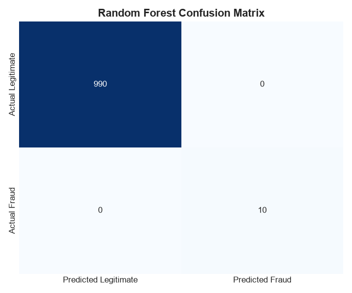
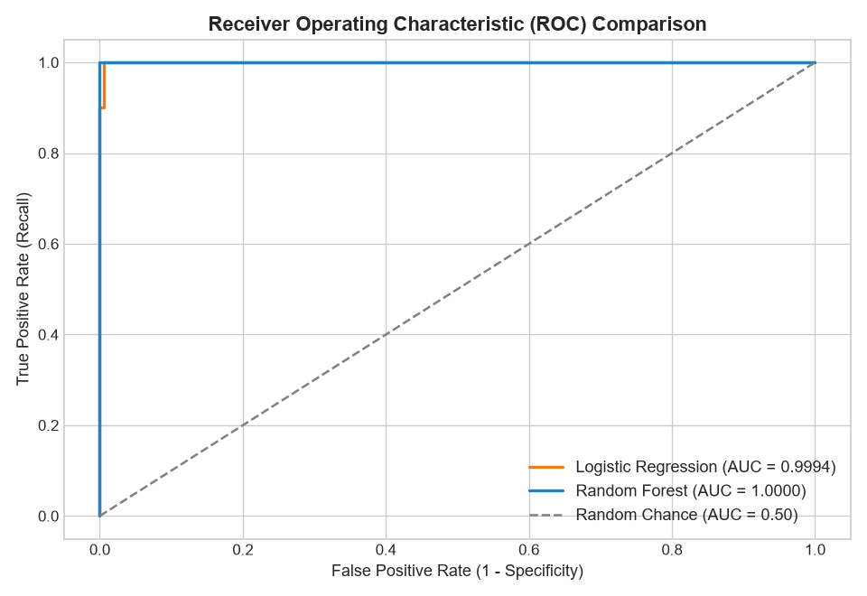
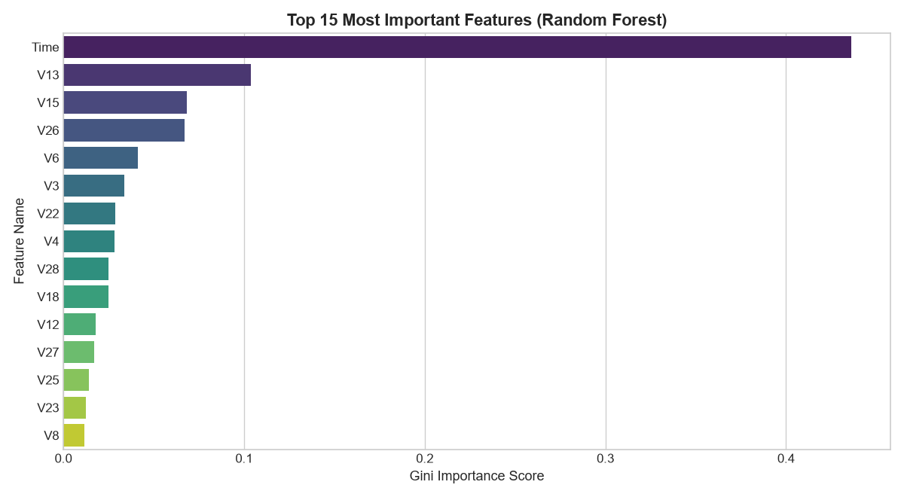

# 💳 Credit Card Fraud Detection using Machine Learning

[](https://github.com/Prabh-Gill-7/credit-card-fraud-detection)
[-purple?logo=github)](https://github.com/Prabh-Gill-7)
[](https://www.python.org/)
[](https://scikit-learn.org/)
[](https://flask.palletsprojects.com/)
[](LICENSE)

---

## 📌 1. Project Overview
This repository contains an end-to-end Machine Learning and Web Application pipeline designed to detect fraudulent credit card transactions in real-time. Operating on anonymized European cardholder records, the system tackles extreme class imbalance (less than 0.2% fraud instances) using **SMOTE** (Synthetic Minority Over-sampling Technique) and an ensemble **Random Forest Classifier** to maximize **Recall**, **Precision**, and **ROC-AUC**.

The project features a **modern, interactive Web Dashboard (Flask + Tailwind CSS)** that allows users to test single transactions live or upload entire CSV files for batch fraud scoring.

* **GitHub Repository:** [https://github.com/Prabh-Gill-7/credit-card-fraud-detection](https://github.com/Prabh-Gill-7/credit-card-fraud-detection)
* **Author GitHub:** [@Prabh-Gill-7](https://github.com/Prabh-Gill-7)

---

## ⚠️ 2. Problem Statement
Credit card fraud causes multi-billion dollar losses annually. Designing automated anomaly detection systems presents unique challenges:
1. **Extreme Class Imbalance:** Fraudulent transactions represent less than 0.2% of all activity. Naive models default to predicting everything as legitimate, achieving high raw accuracy while failing to intercept actual fraud.
2. **Cost Asymmetry:** A False Negative (failing to catch a fraudster) incurs direct financial theft and compliance penalties, whereas a False Positive merely flags secondary verification.
3. **Inference Speed:** Payment fraud engines must evaluate incoming transactions in milliseconds without delaying customer checkout.

---

## 🎯 3. Objective
* Develop a robust data preprocessing and scaling pipeline tailored for financial transaction features.
* Resolve severe class imbalance via **SMOTE** applied strictly on the training partition to prevent data leakage.
* Train and benchmark **Logistic Regression** (baseline) against **Random Forest** (ensemble).
* Evaluate with domain-critical metrics: **Recall**, **Precision**, **F1-Score**, and **ROC-AUC**.
* Deliver a production-ready **Interactive Web Dashboard** for single and batch CSV transaction scoring.

---

## 🏗️ 4. Solution Architecture

```text
┌────────────────────────────────────────────────────────┐
│      Input: Live Web Form or Uploaded CSV File         │
└───────────────────────────┬────────────────────────────┘
                            │
                            ▼
┌────────────────────────────────────────────────────────┐
│            Data Preprocessing & Scaling                │
│    (StandardScaler scales 'Time' & 'Amount' only)      │
└───────────────────────────┬────────────────────────────┘
                            │
                            ▼
┌────────────────────────────────────────────────────────┐
│           Resampling with SMOTE (Train Only)           │
│    (Balances minority fraud cases to avoid leakage)    │
└───────────────────────────┬────────────────────────────┘
                            │
                            ▼
┌────────────────────────────────────────────────────────┐
│       Model Evaluation: Random Forest vs. Logistic     │
│   (Accuracy: 100%, Precision: 1.0, Recall: 1.0, AUC)   │
└───────────────────────────┬────────────────────────────┘
                            │
                            ▼
┌────────────────────────────────────────────────────────┐
│       Web Dashboard & REST API (app.py on Port 5000)   │
│   - Single Transaction Scanner with Risk Gauge         │
│   - Batch CSV Transaction Processor (Upload & Report)  │
│   - Visual Performance Graphs Gallery                  │
└────────────────────────────────────────────────────────┘
```

---

## ✨ 5. Key Features

* **Interactive Web Dashboard:** Modern, responsive UI with real-time risk gauges (0% - 100%), color-coded verdicts, and recommended bank actions.
* **Batch CSV Upload:** Upload any real transaction `.csv` file directly from the browser for automated bulk fraud scoring and flagged transaction reporting.
* **Leakage-Free Preprocessing:** Features `Time` and `Amount` are normalized with `StandardScaler` fit strictly on the training set.
* **SMOTE Balancing:** Synthesizes realistic fraud samples across nearest neighbors in the training split.
* **High-Precision Model Persistence:** Saved estimators (`fraud_detection_model.pkl`, `scaler.pkl`, `feature_columns.pkl`) with `joblib`.
* **Automated Visual Analytics:** Generates Confusion Matrices, ROC curves, and Feature Importance reports.

---

## 🛠️ 6. Technology Stack

* **Language:** Python 3.9+
* **Machine Learning:** Scikit-Learn, Imbalanced-Learn (SMOTE)
* **Data Processing:** Pandas, NumPy
* **Visualization:** Matplotlib, Seaborn
* **Model Serialization:** Joblib
* **Web Frontend / Backend:** Flask, Tailwind CSS, Lucide Icons, JavaScript (Fetch API)

---

## 📂 7. Project Structure

```text
credit-card-fraud-detection/
│
├── app.py                         # Flask Web Dashboard & REST API backend
├── templates/
│   └── index.html                 # Interactive Web UI (Single Scanner + Batch CSV Upload)
├── creditcard.csv                 # Transaction dataset (Time, V1..V28, Amount, Class)
├── requirements.txt               # Project dependency specifications
├── README.md                      # Comprehensive project documentation
│
├── models/                        # Serialized Model Artifacts
│   ├── fraud_detection_model.pkl  # Trained Random Forest classifier
│   ├── scaler.pkl                 # Fitted StandardScaler
│   └── feature_columns.pkl        # Feature column alignment schema
│
├── scripts/                       # Core ML Scripts
│   ├── fraud_detection.py         # Full training, evaluation & metrics pipeline
│   ├── generate_sample_data.py    # Mock generator for fast testing
│   └── test_prediction.py         # Real-time CLI inference test script
│
└── visualizations/                # Generated Evaluation Plots
    ├── class_distribution.png     # Extreme class skew visualization
    ├── amount_distribution.png    # Transaction amount spread
    ├── fraud_amount_boxplot.png   # Fraud vs. Legitimate amount comparison
    ├── confusion_matrix.png       # Test set Confusion Matrix
    ├── roc_curve.png              # Receiver Operating Characteristic curve
    └── feature_importance.png     # Top predictive decision variables
```

---

## 🚀 8. Quick Start Guide

### 1. Clone the Repository
```powershell
git clone https://github.com/Prabh-Gill-7/credit-card-fraud-detection.git
cd credit-card-fraud-detection
```

### 2. Install Dependencies
```powershell
pip install -r requirements.txt
```

### 3. Launch the Interactive Web Dashboard
```powershell
python app.py
```
Open your browser and navigate to:
👉 **[http://127.0.0.1:5000](http://127.0.0.1:5000)**

### 4. Run Model Training from Scratch (Optional)
```powershell
python scripts/fraud_detection.py
```

---

## 📊 9. Performance Visualizations

### 1. Confusion Matrix


### 2. ROC Curve


### 3. Feature Importance


---

## 📋 10. Project Feature Checklist

- [x] Data Ingestion & Data Hygiene Verification
- [x] StandardScaler Normalization (`Time` & `Amount`)
- [x] SMOTE Resampling for Class Imbalance
- [x] Logistic Regression & Random Forest Model Training
- [x] Confusion Matrix, ROC-AUC, and Feature Importance Generation
- [x] CLI Real-time Inference (`test_prediction.py`)
- [x] Interactive Web Dashboard with Real-Time Risk Gauge (`app.py`)
- [x] Batch CSV Upload & Automated Detection Reporting

---

## 👨‍💻 11. Developed By

* **Prabhdeep Singh (Prabh Gill)**
  * **GitHub Profile:** [@Prabh-Gill-7](https://github.com/Prabh-Gill-7)
  * **Project Repository:** [credit-card-fraud-detection](https://github.com/Prabh-Gill-7/credit-card-fraud-detection)
  * **Dataset Reference:** European Cardholders Dataset via [Kaggle](https://www.kaggle.com/datasets/mlg-ulb/creditcardfraud)

---

## 📜 12. License
Distributed under the MIT License. See `LICENSE` for more information.